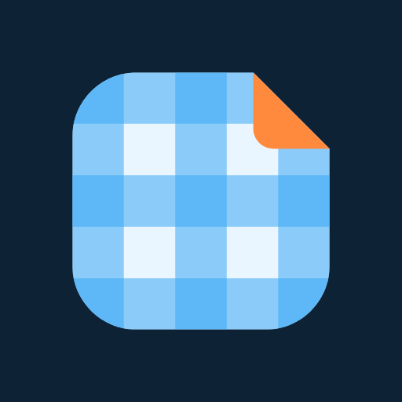
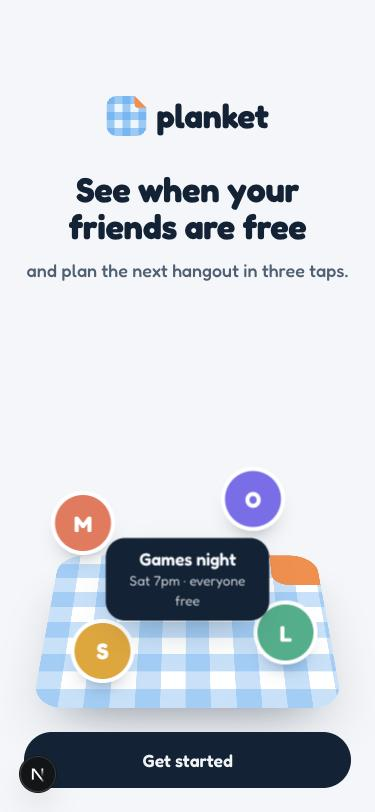
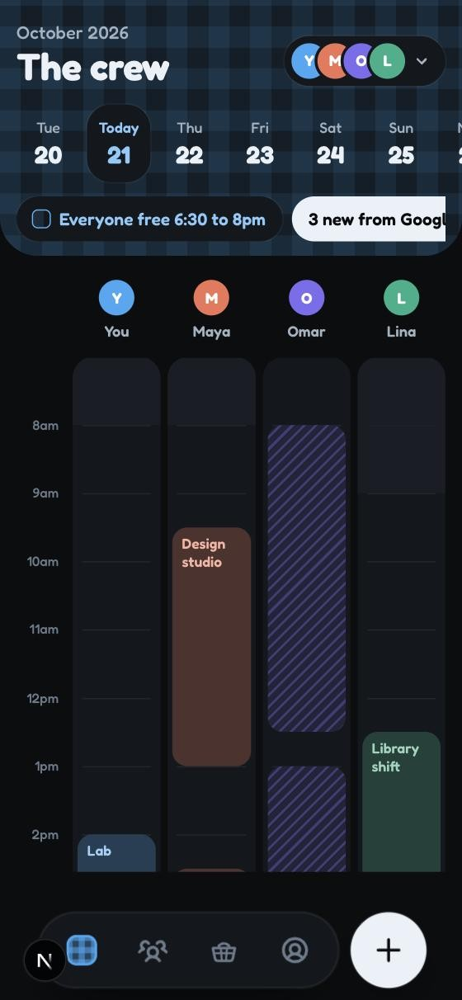
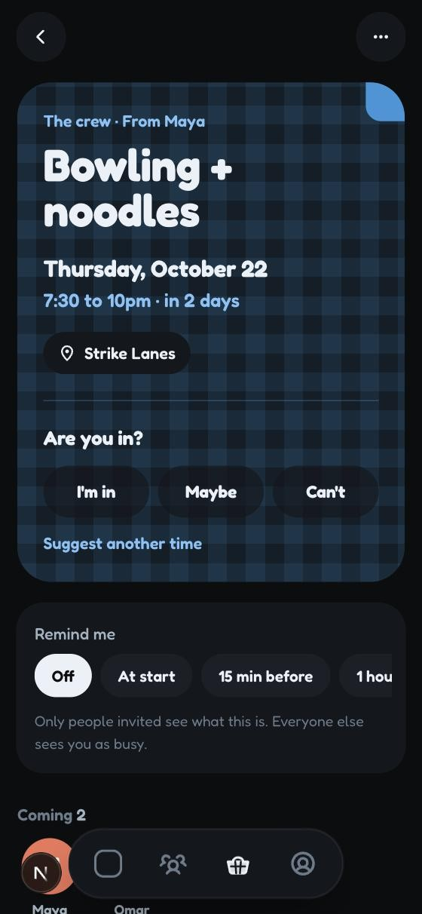
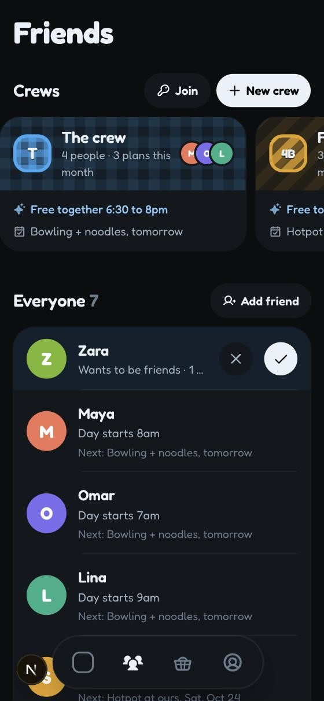
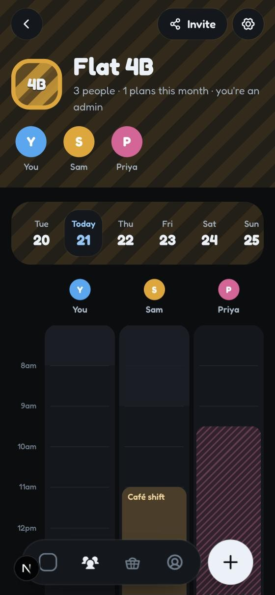
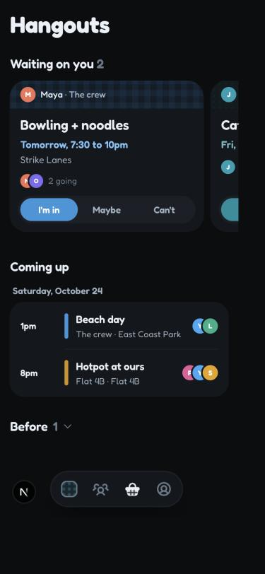
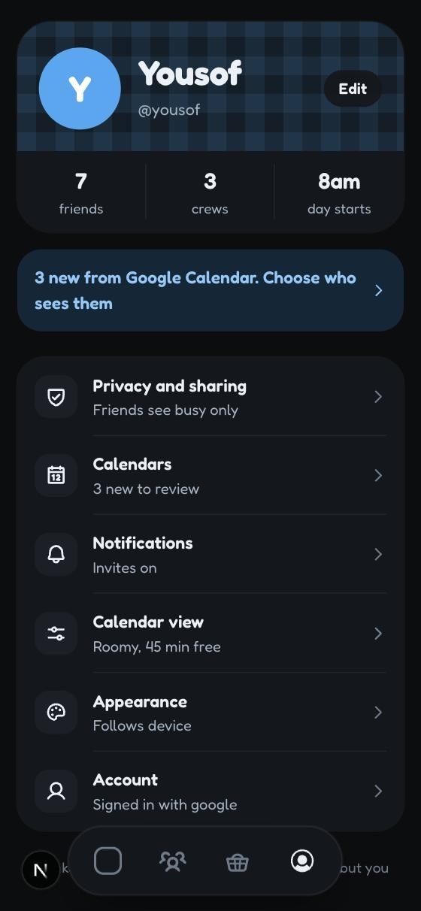
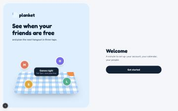

<h1 align="center">Planket</h1>

<b>See when your friends are free. Plan the next hangout in three taps.</b> 
Web · iOS · Android · <a href="https://planket-yeegz.web.app">planket-yeegz.web.app</a>

## The idea

Planning with friends dies in the group chat: "when are you free?", forty messages, nothing booked. Planket lays everyone's day side by side, one column per person, and weaves the stretch when you are **all** free right into the calendar, like the overlapping stripes of a picnic blanket. Tap that stretch, pick what it is, send.

## What it does

- **Day view for a crew or a friend**: busy time in each person's colour, private time as soft stitching, the shared free stretch woven in gingham, with ideas that fit it (lunch at noon, a movie on a long evening, a day out on a free Saturday).
- **Three-tap plans**: the invite card arrives filled in from where you tapped; nothing is chosen for you; drag the time, see who becomes busy, pick a reminder and who can see it.
- **Answers that move**: In, Maybe, Can't, or suggest another time; the host moves the plan in one tap and everyone is asked again.
- **Crews like circles**: each crew has its own colour and blanket pattern (header, card, mark and even the Calendar tab icon wear it), a six-character join code with QR, admins, approval for new members, and per-crew calendar settings.
- **Private by default**: friends see busy, not what; new Google Calendar events wait for your say; nobody can change your calendar but you. Report and block everywhere people appear.
- **A daylight onboarding**: a picnic blanket is laid down, friends drop onto it, then account, photo, calendar, hours and crew are set up in under a minute.

## Engineering

- **One codebase, three targets**: Next.js 16 static export served on the web and wrapped with Capacitor 8 into native iOS and Android apps (haptics, status bar, splash, deep links, share sheet).
- **Time is hard, so it is tested**: free time across time zones and daylight-saving days, reply and suggestion state, idea ranking and the Google Calendar mapping are pure modules with 50 tests.
- **Backend designed for privacy**: Supabase Postgres with row-level security on every table (friends only see each other's busy blocks, titles only when shared), Google OAuth with Calendar scopes and a server-side token refresh function.
- **Motion with a reason**: React View Transitions for spatial navigation, springs only in answer to a touch, no ambient animation, full reduced-motion support.
- **Every size**: from 320 px phones to wide desktops (bottom bar, rail and side panel), text scales with system settings.

## Status (honest)

| Part | State |
|---|---|
| Web app | Live on Firebase Hosting, runs on demo data on your device |
| iOS app | Builds and archives; TestFlight upload pending |
| Android app | Builds (debug APK, release AAB); Play listing pending |
| Accounts + Google Calendar sync | Built and tested in code; waiting on Supabase and Google Cloud projects to go live |
| Push notifications | Settings exist; delivery not built yet |

The source is private. Built by **Yousof Selim** ([@yeegz](https://github.com/yeegz)).
